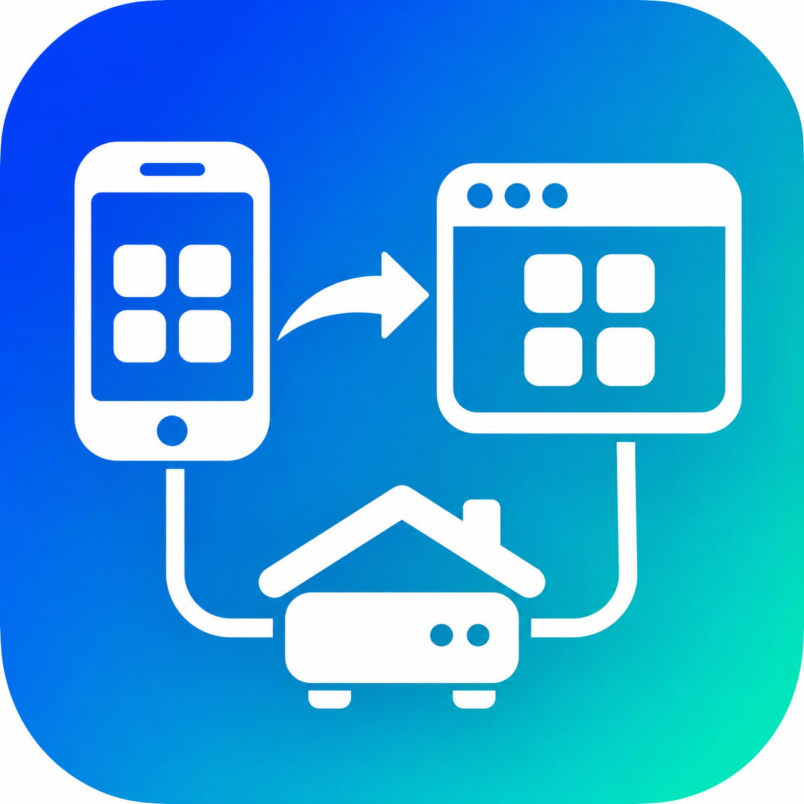

<p align="center">
  
</p>

# app-to-pwa-casaos

A [Claude](https://claude.com) skill that turns your native mobile app into a **Progressive Web App that looks,
animates and behaves exactly like the original**, with a small backend you host yourself on
**[CasaOS](https://casaos.io)** (or any Docker box, Raspberry Pi included), installed with one command and
updated every night.

> 🇮🇹 Una skill per Claude che converte la tua app nativa (Android, iOS, Flutter, React Native) in una PWA identica
> per grafica, animazioni e utilizzo, con un piccolo server da ospitare sul tuo CasaOS: installazione guidata con un
> solo comando, account per ogni persona di famiglia, notifiche push e aggiornamenti automatici ogni notte.

It was extracted from a real conversion: [Money](https://github.com/carellice/money), an Android (Kotlin, Jetpack
Compose) finance app whose PWA lives in [`PWA/`](https://github.com/carellice/money/tree/main/PWA).

## What Claude builds for you

```
PWA/
├── shared/   model, dates, formatting, business logic (used by server and web)
├── server/   Node 24 + built-in SQLite, accounts, background jobs, Web Push, no framework
├── web/      React + Vite + framer-motion, every screen ported 1:1
├── casaos/   installa.sh (guided installer), aggiorna.sh (update + rollback), HTTPS certificates
└── Dockerfile
```

- **Identical UI**: same colors, fonts, shapes, copy. Compose/SwiftUI springs and easings converted exactly,
  Kotlin's `Random(seed)` reproduced bit for bit so generated shapes match, Material icons from the same set.
- **Your native app stays untouched**: everything lives in its own folder. Unless you want the
  opposite: an optional **server mode** in the native app's settings makes the phone use the same
  account and data as the PWA (it keeps working offline and sends the changes when the server is
  back; changes from the PWA show up within 30 seconds).
- **Accounts**: username and password, no email. Each person gets private data (their own SQLite file).
- **Native features mapped**: notifications → Web Push, background workers → server jobs, biometric lock →
  WebAuthn passkey, camera, voice, PDF/share, backups compatible with the native app.
- **One-command install** on the server, with HTTPS through Tailscale, a local certificate or your reverse proxy;
  the app appears in the CasaOS dashboard. Several apps can share one server: each gets its own Tailscale HTTPS
  port automatically (443, then 8443, 10000...), without taking over the others' links.
- **Nightly auto-update**: when you bump the version on GitHub, servers rebuild, back up every database, switch
  over and roll back by themselves if the new version doesn't start.

Claude starts by asking a few multiple-choice questions (accounts, sign-up policy, features to port, HTTPS,
updates, language, native app on the server), studies your app and writes a porting checklist before touching code.

## Install the skill

**Claude Code**

```bash
git clone https://github.com/carellice/app-to-pwa-casaos ~/.claude/skills/app-to-pwa-casaos
```

Then, in your app's repository, ask something like:

> Convert this app into a PWA identical to the Android version and make it installable on my CasaOS server.

**Claude.ai / Claude desktop**: download `app-to-pwa-casaos.skill` from the
[latest release](https://github.com/carellice/app-to-pwa-casaos/releases/latest) and add it in
Settings → Capabilities → Skills. A full conversion needs a code environment with your repository
(Claude Code is the best fit).

## What the people using your app get

On the CasaOS server:

```bash
curl -fsSL https://raw.githubusercontent.com/<you>/<your-repo>/main/PWA/casaos/installa.sh | sudo bash
```

The script asks for the data folder, port, time zone and HTTPS mode, builds the Docker image, registers the app in
CasaOS, links Tailscale if present, and offers nightly updates. Then everyone opens the address on their phone,
creates an account and installs it as an app (Android: Chrome ⋮ → Install app; iPhone: Safari Share → Add to Home
Screen).

The installer and update messages are written in Italian; Claude translates them to your app's language during
the conversion.

## Updating the skill

Skills don't update by themselves. Claude Code: `git -C ~/.claude/skills/app-to-pwa-casaos pull`.
Claude.ai: download the new `.skill` from the latest release and add it again.

## Contents

| Path | What it is |
|---|---|
| `SKILL.md` | The workflow Claude follows |
| `references/` | Study of the native app, UI fidelity, server, web platform, CasaOS deployment, native app server mode, verification |
| `assets/template/` | Ready files: accounts, per-user SQLite, routes, Web Push, service worker, nav stack, store, WebAuthn lock, Kotlin Random port, Dockerfile, installer, updater, porting checklist |
| `assets/native-android/` | Server mode for an Android app: API client with encrypted session, network security config |
| `scripts/scaffold.py` | Creates the PWA folder from the templates with your app's names |
| `scripts/app_icons.py` | PWA icons from your launcher icon (Pillow) |
| `scripts/material_icons.mjs` | Material Icons as inline SVG paths, same glyphs as Compose |

## License

MIT
